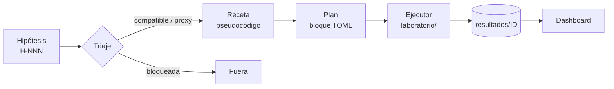

<div align="center">

# edge_factory

**Laboratorio de validación de hipótesis de trading sistemático**

De la idea al resultado medido, solo con datos in-sample.


</div>

---

## Qué hace

Toma hipótesis de trading sacadas de papers (o propias), comprueba si se pueden testear con los datos disponibles, las traduce a una especificación y las ejecuta contra datos históricos. Cada experimento deja una salida estandarizada que un dashboard muestra para revisión humana.

El laboratorio **mide**; no puntúa ni recomienda. La decisión es siempre humana.

## Flujo



| paso | entrada → salida | dónde |
|---|---|---|
| **Triaje** | hipótesis → `compatible` · `proxy` · `bloqueada` según los datos | [`triaje/indice.md`](triaje/indice.md) |
| **Receta** | hipótesis → reglas en pseudocódigo con citas | [`estrategias/`](estrategias/) |
| **Plan** | receta → experimento fijado antes de calcular (TOML) | [`experimentos/`](experimentos/) |
| **Ejecución** | plan → backtest, métricas y batería de robustez | [`laboratorio/`](laboratorio/) |
| **Resultados** | `resumen.json` · `equity.csv` · `operaciones.csv` · `ficha.md`, y la misma operativa al 100 % del capital (`equity_100.csv`, `operaciones_100.csv`) | [`resultados/`](resultados/) |

## Principios

> 🔒 **In-sample por defecto.** La muestra IS va de 2009-09-27 a 2020-12-31. OOS y holdout no se usan sin autorización explícita y concreta, que se registra por experimento; el plan OOS debe repetir sin cambios la especificación IS. Las fechas viven en un único sitio (`laboratorio/proteccion.py`) y el contrato rechaza cualquier otra muestra.

- 🧩 **Sin código por hipótesis.** Una hipótesis es una especificación TOML. Si falta una pieza (dataset, ventana, estadístico) se añade de forma genérica al catálogo, con su test.
- ⚖️ **Riesgo comparable.** Cada resultado incluye, además del tamaño del plan, la misma operativa al 100 % del capital (drawdown, duración, recuperación).
- 📐 **Salida con contrato.** Los resultados se validan con pydantic y se exportan como JSON Schema en [`esquemas/`](esquemas/).
- 🧪 **Exploratorio por defecto.** Ninguna ficha es una conclusión; la siguiente comprobación se propone, no se ejecuta sola.
- 📚 **Conocimiento acumulado.** Hallazgos y definiciones en [`conocimiento/`](conocimiento/), una nota por hipótesis o concepto (compatible con Obsidian).

## Estado

| | |
|---|---|
| Hipótesis triadas | **62** · 19 compatibles · 6 proxy · 37 bloqueadas (las bloqueadas necesitan datos que no hay) |
| Recetas | H-001 · H-007 · H-008 · H-010 · H-018 · H-019 · H-073 · H-PROPIA-003 |
| Experimentos | 8 hipótesis probadas, 51 experimentos · H-001 en SPY, QQQ, IWM y DIA (OOS de QQQ: sin efecto) · H-007 en ES y NQ (OOS 2021–2026: sin ventaja fuera de muestra) · H-010 en ES (no cubre costes) · H-018 en SPY (víspera de festivo: IC por encima de cero fuera de muestra; **candidata**) · H-019 (OOS de SPY: sin efecto) · H-073 y H-PROPIA-003 en ES y NQ (momentum al cierre, solo IS) · H-PROPIA-001 en RAY |
| Tests | 89, con datos sintéticos |

Todas las hipótesis, sus variantes y sus cifras en [`INDICE.md`](INDICE.md) (y en [`resultados/indice.csv`](resultados/indice.csv) para máquinas).

## Estructura

```
edge_factory/
├── triaje/          clasificación de hipótesis según los datos
├── estrategias/     recetas en pseudocódigo
├── INDICE.md        índice legible: hipótesis → variantes → IS/OOS/Total (generado)
├── experimentos/    planes: <H-NNN-nombre>/<ID>-<variante>.md
├── laboratorio/     motor: datos → backtest → robustez → métricas → ficha
├── resultados/      espejo de experimentos/ (<H-NNN-nombre>/<ID>-<variante>/) + indice.csv
├── esquemas/        JSON Schema de la salida
├── conocimiento/    notas por hipótesis y conceptos
├── dashboard/       interfaz de lectura (Vite + ECharts)
├── tests/           tests con datos sintéticos
└── data/            datos históricos (no versionados)
```

## Uso

```sh
# entorno
python3.11 -m venv .venv && .venv/bin/pip install -r requirements.txt

# ejecutar un plan → resultados/<H-NNN-nombre>/<ID>-<variante>/ (no sobrescribe)
.venv/bin/python -m laboratorio ejecutar experimentos/<H-NNN-nombre>/<ID>-<variante>.md

# validar y regenerar la ficha
.venv/bin/python -m laboratorio ficha resultados/<H-NNN-nombre>/<ID>-<variante>

# reconstruir el índice
.venv/bin/python -m laboratorio indice

# añadir el riesgo al 100 % del capital a resultados antiguos (reejecuta y verifica)
.venv/bin/python -m laboratorio referencia resultados/<H-NNN-nombre>/<ID>-<variante>

# tests
.venv/bin/python -m unittest discover -s tests
```

### Dashboard

```sh
cd dashboard && npm install && npm run dev
```

Lee `resultados/` en solo lectura: portada con todas las hipótesis, ficha por hipótesis y comparativa entre instrumentos.

## Datos

`data/` no se versiona (datos de proveedores); `resultados/` sí, así que fichas, índice y dashboard se pueden revisar sin los datos. Incluye diarios de SPY, QQQ, IWM y DIA, futuro ES en 15 minutos y series cripto (RAY, BTC y volumen de Raydium).
